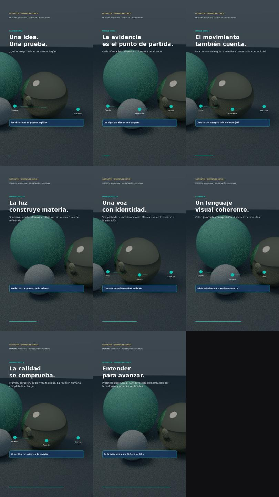

# GoToGym Quantum Coach · Sistema audiovisual

Estudio local para producir explicativos de 60 segundos con evidencia, guion, cámara, imagen, sonido y revisión. Implementa una **versión de referencia ejecutable** de los cinco manuscritos científicos de Juan Manuel Goenaga Castro. El formalismo tensorial QAF se atribuye en los documentos a Antoni Bancells.



## Empezar

Requisitos: **Python 3.11 o superior**, **FFmpeg y FFprobe** disponibles en PATH. Funciona sin GPU, claves de nube ni Blender. La instalación inicial de dependencias requiere conexión.

1. Descarga y extrae el proyecto.
2. Windows: abre `start_studio.bat`. macOS/Linux: ejecuta `bash start_studio.sh`.
3. Abre **http://127.0.0.1:8765** y pulsa **Nuevo episodio**.
4. Genera el storyboard, modifica el proyecto y exporta un MP4.

El primer episodio es conceptual: ocho planos, música original y un estudio de luz generado por el render CPU. Puedes importar tus imágenes, clips, logo y grabación. El montaje admite vertical y horizontal; los recursos grandes se copian a `projects/<episodio>/assets`.

Instalación manual:

```bash
python -m venv .venv
# Linux/macOS: source .venv/bin/activate
# Windows: .venv\Scripts\activate
python -m pip install .
python -m qaf_video doctor
python -m qaf_video serve --workspace projects
```

## Qué funciona

| Manuscrito | Implementación incluida |
|---|---|
| I · Fundamentos QAF | Registros de afirmaciones y fuentes, compuerta documental, normalización con máscara, estados densidad/POVM, MPS, RDM por contracción, referencia TDVP y QUBO con restricciones. |
| II · Cinematografía | Timeline a cuadros enteros, guion editable, cámara minimum jerk, SLERP, recorte por formato, tipografía, subtítulos y storyboard. |
| III · Render híbrido | Path tracer CPU de esferas difusas y espejos, luces de área, sombras y rebotes; adaptador local a Blender/Cycles; composición lineal sRGB; DAG y caché por contenido. |
| IV · Voz y sonido | Voz grabada o TTS opcional, tiempos reales del proveedor, SRT/VTT, cuatro stems, ducking y normalización medida en dos pasadas. |
| V · Validación | Catálogo de 56 perfiles con artefactos de revisión, controles de entrega, pruebas automatizadas, benchmark y registro de revisión humana. |

La matriz detallada, límites y rutas de código están en [docs/IMPLEMENTACION.md](docs/IMPLEMENTACION.md). Los [cinco PDF y sus fuentes editables](docs/manuscripts/) forman parte del proyecto.

## Generar un episodio por consola

```bash
python -m qaf_video init projects/episodio-01
python -m qaf_video validate projects/episodio-01/project.json
python -m qaf_video plan projects/episodio-01/project.json --out projects/episodio-01/outputs/plan.json
python -m qaf_video storyboard projects/episodio-01/project.json --out projects/episodio-01/outputs/storyboard.jpg
python -m qaf_video render projects/episodio-01/project.json --profile proxy --out projects/episodio-01/outputs/video.mp4
```

Para 1080 × 1920 usa `--profile vertical`; para 1920 × 1080, `--profile horizontal`. Las pruebas de ambos formatos usan `proxy` y `landscape-proxy`. Una exportación a resolución completa sigue siendo un borrador si no registra revisiones.

La opción `--final` exige composición lineal, afirmaciones vinculadas y verificadas, voz y logo originales, subtítulos vinculados al hash del audio, procedencia de recursos y revisiones fechadas de marca, voz, afirmaciones, derechos, imagen y accesibilidad. Estos son **controles de registros**, no una verificación semántica automática de la verdad, derechos o calidad artística. Consulta [docs/PRODUCCION.md](docs/PRODUCCION.md).

## Voz colombiana

### Tu propia referencia regional · versión 0.3

El estudio admite notas OGG de WhatsApp, compara variantes de procesamiento con límites de preservación y prepara un perfil de voz local. En **Voz y recursos**, importa las muestras, selecciónalas en **Tu voz de marca** y pulsa **Preparar referencia**. Las comparaciones A/B usan el mismo objetivo de sonoridad.

Para generar guiones nuevos con esa referencia, instala una vez el motor opcional (descarga aproximada de 3 GB de modelos):

```bash
python scripts/setup_local_voice.py
```

Reabre el estudio, elige el perfil, escribe el guion y pulsa **Generar con mi referencia**. También puedes usar la CLI:

```bash
python -m qaf_video voice-prepare muestras/uno.ogg muestras/dos.ogg --out projects/episodio-01/voice-profiles/barranquilla
python -m qaf_video voice-clone --profile projects/episodio-01/voice-profiles/barranquilla/voice-profile.json --text-file projects/episodio-01/narration-es.txt --out projects/episodio-01/assets/voice.wav
```

La síntesis utiliza **Qwen3-TTS Base** preentrenado y transcripción local con **faster-whisper**; el módulo matemático selecciona procesamiento y referencia. No se afirma haber entrenado un vocoder QAF. La inferencia desactiva telemetría antes de importar los motores y usa pesos locales; en Linux un proceso aislado bloquea las llamadas de red. Las muestras y perfiles se conservan como recursos privados del proyecto y no forman parte del código público. Consulta [docs/VOZ.md](docs/VOZ.md).

Los subtítulos provienen de tiempos de ASR, con revisión pendiente. Solo se vincula automáticamente una locución que cabe en el episodio y supera la comparación inicial con el guion. La semejanza, naturalidad, acento regional y pronunciación necesitan aprobación escuchando.

Puedes elegir entre los diez idiomas admitidos por Qwen3-TTS, o activar **Definir el idioma de cada frase** para insertar expresiones inglesas dentro de una narración española. Se mantiene la misma referencia vocal y se reconoce cada frase en su idioma. En consola usa `--language en` con `--text-file`, o `--segments-file examples/narration-multilingual.json`. El guion no se traduce automáticamente y el modo `Auto` no garantiza la pronunciación de nombres. La comparación revisa cada frase para evitar que se omitan términos extranjeros. Consulta [la guía de pronunciación multilingüe](docs/VOZ.md#palabras-y-frases-en-otros-idiomas).

### Alternativa de catálogo

Puedes usar una locutora de Barranquilla y cargar la grabación. Para probar el adaptador en línea:

```bash
python -m pip install ".[voice]"
python -m qaf_video voice --list --locale es-CO
python -m qaf_video voice --text-file projects/episodio-01/narration-es.txt --out projects/episodio-01/assets/voice.mp3
python -m qaf_video attach-voice projects/episodio-01/project.json --asset assets/voice.mp3 --captions projects/episodio-01/assets/voice.voice.json
```

El candidato por defecto es `es-CO-SalomeNeural`. El catálogo depende del servicio externo. **La etiqueta colombiana no acredita acento barranquillero**: la grabación necesita audición local. Este adaptador de catálogo no incluye clonación de voces. Envía únicamente el texto indicado al proveedor cuando se ejecuta explícitamente.

## Render, investigación y automatización

```bash
python -m qaf_video native-render --out projects/luz.png --samples 64
# Solo si Blender está instalado:
python -m qaf_video blender-render --out projects/cycles.png --samples 64
python -m qaf_video benchmark --out projects/benchmark.json
# Primero crea projects/episodio-01:
python -m qaf_video build examples/workflow.json --workspace projects
python -m unittest discover -s tests -v
```

El planificador aplica una referencia clásica exacta a alternativas editoriales; los pesos son ilustrativos y no cambian las afirmaciones. La dinámica tensorial se limita a sistemas pequeños y no se presenta como una ventaja cuántica. El asignador de muestras es un asesor matemático independiente, no muestreo adaptativo integrado al path tracer.

## Alcance de esta entrega

- El sistema exporta MP4 H.264/AAC SDR; conserva informes, hashes y mediciones. La composición de entrega es lineal entre capas sRGB de 8 bits, sin certificación ACES/HDR.
- El render CPU es una referencia acotada: esferas, reflexión ideal y materiales difusos. No incluye piel, telas, pelo, volúmenes o geometría arbitraria. Blender amplía el flujo cuando se instala por separado.
- No contiene un generador neuronal de video, un modelo regional entrenado desde cero ni un benchmark que demuestre liderazgo mundial. La síntesis opcional usa un modelo preentrenado condicionado por la referencia. La producción cinematográfica necesita material, dirección y revisión profesional.
- El servidor escucha solo en `127.0.0.1`. Está diseñado para un equipo local, sin autenticación multiusuario ni despliegue público. Las escrituras exigen token y origen local; las rutas están confinadas al espacio de proyectos.
- No publica videos ni contacta personas automáticamente. No incorpora el código privado de la app GoToGym.

Ver [docs/VALIDACION.md](docs/VALIDACION.md), [CHANGELOG.md](CHANGELOG.md) y [NOTICE.md](NOTICE.md). Código y manuscritos: todos los derechos reservados al titular correspondiente; las tipografías mantienen su licencia propia.

## Estudio 0.4: cine, voz continua y pantalla móvil

Descomprime el paquete de plataforma y ejecuta `python iniciar_estudio.py` o su lanzador. Necesita Python 3.11+, FFmpeg y FFprobe. Abre `http://127.0.0.1:8765` y selecciona `running-v2/project.json` en el paquete privado de esta entrega. El repositorio contiene código y artículos; el paquete descargable incluye medios y voz del episodio.

La pestaña **Cine y pantalla móvil** permite seleccionar la captura original, auditar composición y generar el formato elegido. La voz continua admite una tasa objetivo de 175 palabras/minuto; no se obliga a llenar sesenta segundos de habla. Para generar guiones nuevos, instala el motor local por separado con `python scripts/setup_local_voice.py`. Reproducir, componer y renderizar el episodio entregado no requiere descargar esos modelos.

```bash
python -m qaf_video cinema-audit projects/running-v2/project.json --profile vertical
python -m qaf_video cinema-storyboard projects/running-v2/project.json --out outputs/storyboard.jpg
python -m qaf_video cinema-render projects/running-v2/project.json --profile vertical --out outputs/running.mp4
python -m qaf_video cinema-render projects/running-v2/project.json --profile horizontal --out outputs/running-horizontal.mp4
```

`cinema-render --no-cc` genera una versión limpia; SRT y VTT se conservan por separado. Las exportaciones de revisión funcionan sin inventar aprobaciones; `--final` exige revisiones humanas registradas.

Consulta [la auditoría y las ocho mejoras](docs/robustness/AUDITORIA.md), [los resultados ejecutados](docs/validation/robustness-v0.4.json) y [los artículos](docs/robustness/papers). Son prepublicaciones con propuestas computacionales implementadas y estudios perceptuales pendientes. QAF usa su región clásica identificable, sin reclamar ventaja cuántica.
